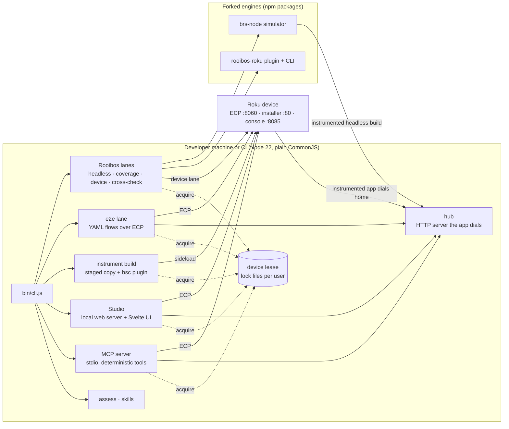
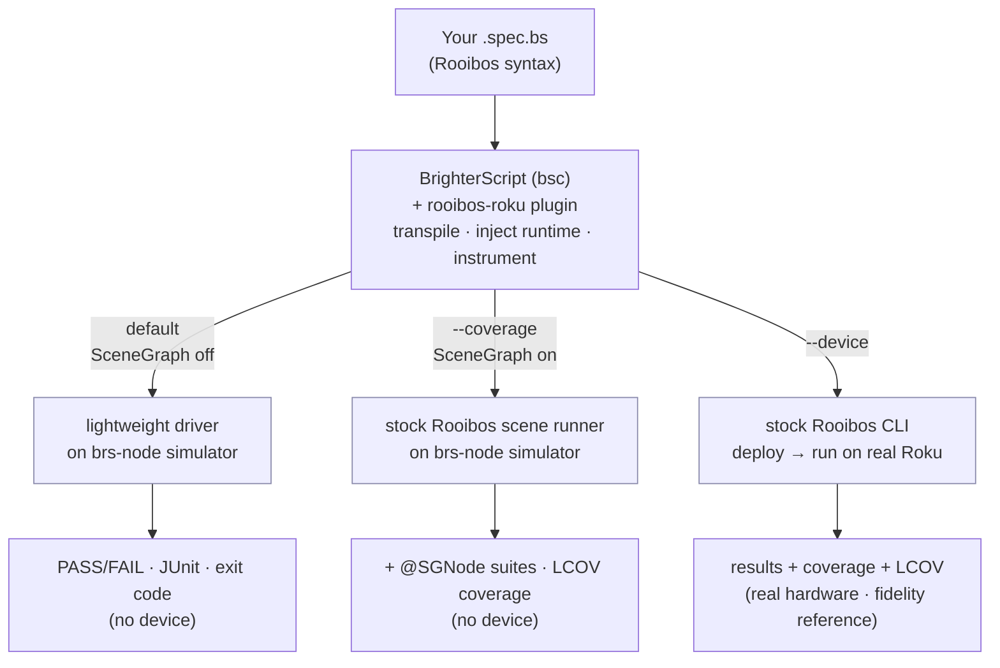
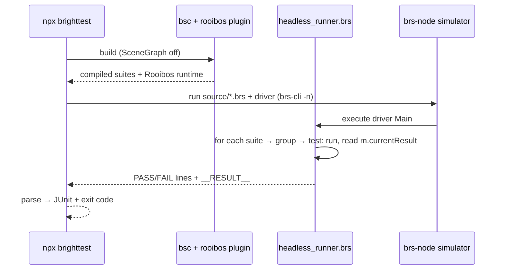
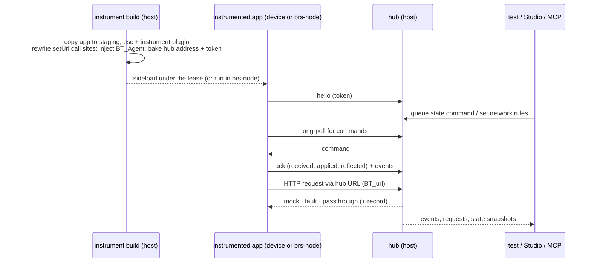
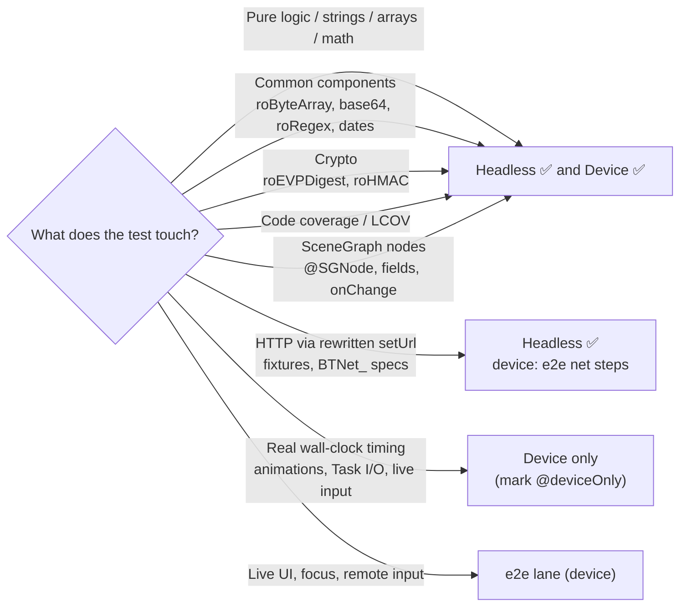

# Architecture

brighttest is a thin orchestration layer over three mature tools (BrighterScript, Rooibos, brs-node). You write Rooibos
specs once; the tool runs them headless (no device) or on a real Roku, and can diff the two to prove the fast lane is
faithful. Around that core it adds an on-device UI lane (e2e), a debug-only instrumentation layer that lets tests and
tools see an app's network traffic and state, a browser workbench (Studio), an agent surface (MCP), and the adoption
tooling (`assess`, bundled skills). Everything that drives a Roku, installs on it or runs tests on it goes through one
device lease; read-only checks (`doctor`, the MCP `device_doctor` tool, the e2e preflight) do not take it.

This page describes the parts and how data flows between them. The reasons behind the main choices are collected in
[Design decisions](/decisions-summary). Code-level internals are in [Maintainer internals](/maintainers).

## System overview

## Components

| Component | Role | Runs where |
|---|---|---|
| **BrighterScript (`bsc`)** | Compiles `.brs` and `.bs`; hosts the Rooibos plugin and brighttest's instrument plugin; builds packages. | Host, build time |
| **rooibos-roku** (fork) | Turns `@suite/@it/@params` specs into runnable suites; injects the test runtime and coverage. Its CLI deploys and runs suites on a device. | Build time, device |
| **brs-node** (fork) | BrightScript and SceneGraph simulator in Node, so `@SGNode` suites and coverage run without a device. | Host |
| **brighttest CLI** | Generates per-lane configs, builds, runs the right lane, parses results, writes JUnit and LCOV. | Host |
| **e2e lane** | Drives a running app over stock ECP and asserts on the live SceneGraph (`query/sgnodes`). No simulator, no Rooibos. | Host to device |
| **Instrumentation** | Builds a debug-only copy of the app with network call sites rewritten and a small state agent injected. Never touches your source tree. | Host build, device or simulator runtime |
| **Hub** | A Node-core HTTP server the instrumented app dials. Serves network mocks, faults and recording, and the state command channel. | Host |
| **Device lease** | One holder per Roku at a time across processes, users' tools and agents. | Host |
| **Studio** | Local web server plus a Svelte client: live screen and tree, flows, profiling, Perfetto, the State and Network panels. | Host |
| **MCP server** | Exposes deterministic primitives (tree, press, navigate, screenshot, app state, flows) to an AI agent over stdio. | Host |
| **assess / skills** | `assess` writes a read-only readiness report for an existing app; `skills` installs agent teaching material, gated against a generated facts file. | Host |

The engines are separate, published fork packages. brighttest never patches or vendors them; engine and framework fixes
are made in the forks, published, and picked up by a dependency bump.

## The Rooibos lanes

`--cross-check` runs the headless and device lanes and diffs every test, so the fast lane can be trusted.

### Headless — default (fast loop)

1. `bsc` builds with the Rooibos plugin, **SceneGraph off**, the fastest configuration.
2. A bundled driver (`brs/headless_runner.brs`) asks Rooibos's generated `RuntimeConfig` for the suite map,
   instantiates each suite, walks its `groupsData → testCases`, invokes each test method (handling `@params`), and
   reads the pass/fail state, reusing **Rooibos's own assertions**.
3. Runs on **brs-node** (`brs-cli -n`). brighttest parses `PASS`/`FAIL`/`__RESULT__` lines, writes optional JUnit, and
   sets a CI exit code. With a project that has `@SGNode` specs, the default lane boots a scene to run them too (pass
   `--no-sgnode` to skip that and stay on the pure SceneGraph-off driver).

The engine runs as an asynchronous child process, so the in-process hub can answer it while a run is in flight
(network fixtures and `BTNet_*` specs use this; see [Network interception](#network-interception)).

### Headless coverage — `--coverage` (no device)

1. `bsc` builds with the Rooibos plugin and **coverage instrumentation plus SceneGraph on**.
2. brighttest runs the **stock Rooibos scene runner on the brs-node simulator**. Because the simulator has a
   SceneGraph engine, this runs `@SGNode` node suites and their `onChange` observer cascades in full, and the coverage
   collector's field observers work, yielding **real LCOV with no device**.
3. brighttest scrapes the printed coverage blocks (ANSI-stripped) and writes `lcov.info`.

### Device — `--device` (the reference)

1. `bsc` builds with the Rooibos plugin and coverage on.
2. brighttest hands off to the **stock Rooibos CLI**, which deploys to the Roku and runs the scene-based runner on
   hardware. Results and coverage come back over the network; `--lcov` writes `lcov.info` locally.
3. The device lane is the fidelity reference: it runs everything, including behaviour tied to real wall-clock timing
   that the simulator only approximates.
4. The device is a leased resource: the lane takes the per-device [lease](/guide/device-lease) around build,
   sideload and run, and queues behind other holders (exit 75 on a wait timeout). An idle watchdog
   (`--idle-timeout`, default 120 s) and the overall `--timeout` fail a run that goes silent or never ends. A run
   with no `[Rooibos Result]` line is a failure. Every flag is listed in the [CLI reference](/guide/cli-reference).

### Cross-check — `--cross-check`

Runs the same specs twice, with two builds: a headless leg on the stock Rooibos scene runner (the `--coverage` path on
brs-node) and a device leg on the Roku. It matches tests by name and reports `agree` / `device-only` / `DIVERGENT`. A
run fails on any divergence, so the headless lane stays a trustworthy proxy.

### How results are read

Results fail closed. The lanes that use the Rooibos runner (the default lane when the project has `@SGNode` specs,
`--coverage`, `--device` and `--cross-check`) fail the run when the streamed cases, the Rooibos summary or the Rooibos
report tree show a failure or crash, taking the largest of the three. A summary that says "Success" while its own
report tree shows a crash does not pass. The SceneGraph-off driver prints a `PASS`/`FAIL` line per test and a
`__RESULT__` total; brighttest counts those, and a run with no `__RESULT__` line fails.

## Why one spec works in every lane

A Rooibos suite compiles to a plain object: test methods plus a metadata structure (`testGroups → testCases`, each
with `funcName`, `name`, `rawParams`). Assertions set `m.currentResult.isFail`. The scene-based runner is just *one*
way to drive that object; the headless driver is another. Same compiled suite, same assertions; only the driver and the
run target differ.

## The e2e lane

The e2e lane tests a **running** app on a real device. It does not build or deploy; it assumes the app is sideloaded.
Flows are YAML files; each step is an ECP call (launch, keypress, text) or an assertion on the live tree read from
`query/sgnodes`. Selectors use a node's built-in `id` (dumped as `name=`), text or subtype. Calls to one device go
through a per-device queue with per-endpoint spacing and one transient retry; a readiness gate waits for the app to
answer after launch; console output on port 8085 is captured per run. The run output holds per-step timing and, when a
hub runs, a hub events file in which app data from the agent is reduced to timing-relevant keys.

With an instrumented build, flows can also set and assert app state and network behaviour through the hub (below).
See [E2E](/e2e/).

## Instrumentation and the hub

Network interception and state access share one mechanism: a **debug-only build** of the app with a small injected
agent that **dials home** to a hub on the developer machine.

- **Build.** `brighttest instrument build` copies the app to a staging folder and compiles it with one bsc plugin.
  The plugin runs after the Rooibos coverage processor, keeps line numbers (same-line rewrites), and reports anything
  it cannot rewrite safely instead of guessing; a strict mode turns those reports into build failures. The injected
  runtime is size-budgeted and shipped with comments stripped. The package carries a per-build token. Your source tree
  is never modified. See [Instrumented builds](/guide/instrument).
- **Release gate.** `brighttest instrument verify <zip>` exits 3 when a package carries any instrumentation marker, so
  CI can refuse to ship a debug build. `instrument census` lists what an app has that the plugin will touch.
- **Transport.** The device opens every connection; nothing listens on the device. The hub runs only while its device
  lease is held, accepts only the leased device (or loopback for headless runs) and a known token (the build's own token, or the
  operator token `BRIGHTTEST_HUB_TOKEN` that `instrument build --net` bakes in), and answers
  everything else with an empty 404. `brighttest doctor` reports the hub bind and, opt-in, proves the device can reach
  it with a short probe build.
- **Network interception.** `roUrlTransfer.setUrl(x)` call sites become `setUrl(BT_url(x))`; `BT_url` prefixes the
  hub's network route once a hub session is live and is the identity otherwise, so an uninstrumented or hub-less run
  behaves normally. The same rewrite serves headless runs (rules from `instrument.net` fixtures or `BTNet_*` specs) and
  device runs (flow `net:` steps, Studio, MCP). On some firmware the render thread cannot create `roUrlTransfer`, so
  `BT_url` there stays the identity; media URLs should be built in a Task, and the build report flags render-thread
  calls. Faults follow the [fault model](/guide/net-faults). Recorded traffic and HAR exports are redacted.
- **State.** The agent reads and writes the scene, global, node, registry and component `m` layers through an
  allow-listed set of operations; the Task layer is read-only snapshots. Component `m` is reached through an injected
  `BT_op` function run in the component's own scope; Task state is captured at Task entry and exit; config-named
  dispatch functions are wrapped to produce an action log. Writes are type-checked; payloads over 64 KB fail with a
  typed error instead of being truncated. Secret-looking keys and configured paths are masked on the agent's `get` and
  snapshot reads before data leaves the app; action-log payloads are masked by key name on the device and by
  `redact.paths` on the host. Studio's `raw=1` views and a fixture saved with `raw: true` skip Studio's host-side masking by
  design (the agent's own masking still applies).

## The device lease

Every command that drives a Roku, installs on it or runs tests on it (Rooibos device lane, e2e, sideload, Studio, MCP
device tools, `device with`, `device reset`) takes a lease on that device first. Read-only checks (`doctor`, the MCP
`device_doctor` tool, the e2e preflight) do not. The lease is a set of lock files in the user's home folder: one holder file per device, FIFO tickets for
waiters, crash recovery by checking the holder's process. There is no broker daemon.

- **Command leases** live as long as one command and belong to its process.
- **Session leases** (`device lock`, the MCP "net window") belong to no process: they expire after an idle period
  (default 10 minutes, renewed by every use) or a hard cap (default 45 minutes). A command carrying the token re-enters
  without queueing.
- **Hygiene.** `e2e run`, `device with` and `device lock` press Home twice after acquiring (config
  `deviceLease.hygiene`, `--no-hygiene` to skip), so the run starts from a known screen. The Rooibos device lane
  presses Home once before deploy. Studio, MCP, `e2e inspect`/`record`, `device reset` and sideload do not press Home
  on acquire. Re-entering a session skips hygiene, except that `e2e run` presses Home when it starts a fresh hub, so a
  resident app relaunches and says hello.
- **Studio** holds a lease only while someone is using it and yields to waiters; **MCP** takes one per tool call, or one
  session lease while its net window is open, and closes the window before the lease record could expire.
- **Agents.** Bundled guidance, an optional Bash guard hook and the CLI itself steer agents to the lease; raw device
  access without a lease token is denied by the hook.
- **Keep-alive.** `device with --keepalive` sends a periodic `Fwd` keypress (default every 240 s) so long runs are not
  stalled by idle timeouts. It is opt-in and uses the lease already held.

See [Device lease](/guide/device-lease).

## Studio

`brighttest studio` starts a local server (loopback only, same-origin, JSON-only mutations except the `.bsprof`
import, which is `application/octet-stream`) and a Svelte client. It
mirrors a leased device: screenshot and tree, key input, flow runs, console, profiling (sgperf, memory, Perfetto
traces summarised in a worker thread with bounded memory), and the State and Network panels backed by a hub. The State
panel offers snapshots, restore, an action log with time travel for apps that have a dispatch function, and saving
snapshots as spec fixtures.

## The agent surface (MCP)

`brighttest mcp` is a hand-rolled stdio JSON-RPC server with no dependency. Its tools are deterministic wrappers over
the e2e primitives: list devices, doctor, inspect the tree, press, navigate, screenshot, read app state, run a flow,
and, under a net window, `net_requests` and `net_mock`. No tool accepts a host, password or absolute path; `run_flow`
takes a project-relative path with no `..`. The device comes from the usual resolution chain. No model runs inside
brighttest: the agent decides, brighttest executes and reports.

## Adoption: assess and skills

- `brighttest assess` writes a read-only, offline report on an existing project: layout, build config, census,
  blockers, a secret scan (key names and locations, never values) and risky patterns, and picks a path
  (`brownfield`, `greenfield` or `not-a-roku-app`); `init --brownfield` and `init --greenfield` set the project up
  for it. See [Assess a project](/guide/assess). It reads the tree through one
  safe-read helper (no symlink following, identity check, size caps, never `.env`, keys or certs) and redacts absolute
  paths in what it prints.
- `brighttest skills` installs agent skills (folder-first, one canonical source adapted per agent), an always-on safety
  block in the agent's instruction file, agent definitions, and, opt-in, the device guard hook and the MCP entry.
  Skills describe; logic lives in the CLI. A generated `skills/facts.json` (version, subcommands, flags, exit codes,
  defaults) gates skill text: `skills --check` fails when a skill claims something the CLI does not do.

## What runs where

Design guideline: keep business logic in pure functions so most tests are trivially headless; the few tests that
genuinely need real hardware timing get marked `@deviceOnly` and skipped on the fast lanes. Anything about the live
screen, focus, render thread or hub reach can only be confirmed on a real device. More in
[Headless vs device](/writing-tests/headless-vs-device).

None of the parts beside the Rooibos lanes (instrument, hub, assess, Studio, MCP) are needed for the default
`brighttest` run, which is unchanged unless you opt in.
