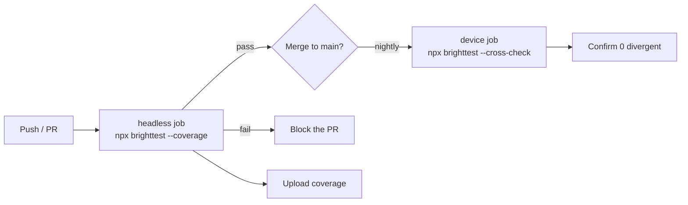

# CI integration

Run the **headless lane on every push** — it's a fast, hardware-free gate that also produces
**code coverage** (`--coverage`). Use the **device lane** occasionally (nightly / pre-release) as a
**fidelity check** via `--cross-check`; it's the only part that needs hardware.



## Exit codes & reports

All flags and exit codes are in the [CLI reference](/guide/cli-reference).

- `brighttest` exits non-zero on any test failure (`1`), on a usage or config error (`2`), and with `75`, `77` or `78` for
  [device lease](/guide/device-lease#exit-codes) problems — fail the job on it. A device run that prints no result line, or
  goes silent past `--idle-timeout`, is a failure.
- `--junit <path>` writes a JUnit XML report for test-result UIs.
- `--lcov [path]` writes an LCOV file for coverage services (Coveralls/Codecov) or `genhtml`. It works on
  the **headless `--coverage` lane** (no device) and on the device lane.

## GitHub Actions — headless gate (with coverage)

Runs on standard GitHub-hosted Linux runners; **no Roku required**. This is the everyday gate and it
uploads coverage.

```yaml
name: tests
on: [push, pull_request]

jobs:
  headless:
    runs-on: ubuntu-latest
    steps:
      - uses: actions/checkout@v7
      - uses: actions/setup-node@v7
        with:
          node-version: '22'
      - run: npm ci
      - run: npx brighttest --coverage --lcov coverage/lcov.info --junit reports/junit.xml
      - if: always()
        uses: actions/upload-artifact@v7
        with:
          name: junit
          path: reports/junit.xml
      - uses: coverallsapp/github-action@v2
        with:
          path-to-lcov: coverage/lcov.info
```

For the fastest possible pure-logic gate, use `npx brighttest --no-sgnode` (skips `@SGNode` suites); run
the `--coverage` job on a separate trigger if you want to keep the per-push gate sub-second.

## Device lane — fidelity check (optional)

`brighttest setup` is for workstations: it writes a project `.env` and a local default. CI uses secrets instead: set `ROKU_HOST` and `ROKU_PASSWORD` in the job environment (the shell variable wins over any `.env`).

The device lane is the only thing that needs hardware, so it runs on a **self-hosted runner** on the same
network as a dev device. You don't need it for coverage — use it to confirm the headless lane still
matches real firmware via `--cross-check` (fails on any divergence). Gate it to a nightly schedule.

```yaml
  cross-check:
    runs-on: [self-hosted, roku]          # a runner that can reach the device
    needs: headless
    if: github.ref == 'refs/heads/main'   # e.g. only on main / nightly
    steps:
      - uses: actions/checkout@v7
      - uses: actions/setup-node@v7
        with:
          node-version: '22'
      - run: npm ci
      - name: Confirm headless matches the device
        env:
          ROKU_HOST: ${{ secrets.ROKU_HOST }}
          ROKU_PASSWORD: ${{ secrets.ROKU_PASSWORD }}
        run: npx brighttest --cross-check --host "$ROKU_HOST" --password "$ROKU_PASSWORD"
```

::: warning Never hard-code device credentials
Put the device IP and developer password in CI **secrets** (`ROKU_HOST`, `ROKU_PASSWORD`) and pass them
via `env:`, as above. Don't inline them in the workflow or commit them.
:::

### Sharing the device with local agents

If the self-hosted runner shares a Roku with developers or agents on the same machine, the
[device lease](/guide/device-lease) serializes them. Label the CI holder and give it a longer wait:

```yaml
    env:
      BRIGHTTEST_AGENT: ci:${{ github.run_id }}
      BRIGHTTEST_LEASE_WAIT: 45m
    steps:
      - run: npx brighttest --cross-check --host "$ROKU_HOST" --password "$ROKU_PASSWORD"
```

`npx brighttest device status` lists device addresses from the lease directory, so keep it out of CI logs; run it from your own shell.

For CI runs against each other, add `concurrency: { group: roku-device, cancel-in-progress: false }`. Leases
across different OS users are not supported; run CI as the same OS user. A wait that times out exits **75**.

## Recommended split

| Trigger | Lane | Why |
|---|---|---|
| Every push / PR | Headless `--coverage` | Fast, hardware-free gate; blocks broken logic immediately, and produces coverage. |
| Nightly / pre-release | Device `--cross-check` | Needs hardware. Confirms the fast lane is still a faithful proxy for real firmware. |
| Manual / pre-release | [`e2e run`](/e2e/scaling) | UI journeys on a real device. Self-hosted runner near a Roku; can't run on GitHub-hosted runners. |

::: tip On-device E2E in CI
The e2e lane needs a real Roku on the runner's LAN, so it runs only on a **self-hosted** runner. The repo
ships a ready workflow at `.github/workflows/e2e-device.yml` — see [E2E → Scaling & CI](/e2e/scaling).
:::

## Engine flavors in this repo's own CI

brighttest's repository runs its suites against more than one engine, so a change to the pinned engines or to
upstream shows up before users see it. The `engines-matrix` workflow runs `patched-pinned` and `stock-latest` on
pull requests that touch `lib/`, `brs/` or `package.json`, and nightly; a `patched-candidate` leg runs on manual
dispatch. Each leg runs `doctor --engines` (the capability probe, which fails when it contradicts the engine's
metadata), the unit and integration suites, the example apps, and the RSG coverage probes against a committed
baseline. The `upstream-canary` workflow builds upstream `master` from a read-only clone and runs the same suites;
it is manual only. See [Refresh the probe baseline](/maintainers#refresh-probe-baseline) when you bump the pin.

## Debug builds (instrument)

To produce an instrumented debug package in CI, run `npx brighttest instrument build --strict`. Exit **0** = package
written, **1** = broken build (nothing written), **4** = strict-mode failure (policy), **3** is the release gate
`instrument verify`. See [Instrumented builds](/guide/instrument).

## Coverage services

`coverage/lcov.info` is standard LCOV, so it feeds Coveralls, Codecov, or a local HTML report:

```bash
genhtml coverage/lcov.info --output-directory coverage/html
```

brighttest filters framework-internal records out of the LCOV automatically, so reported coverage reflects
*your* code.
