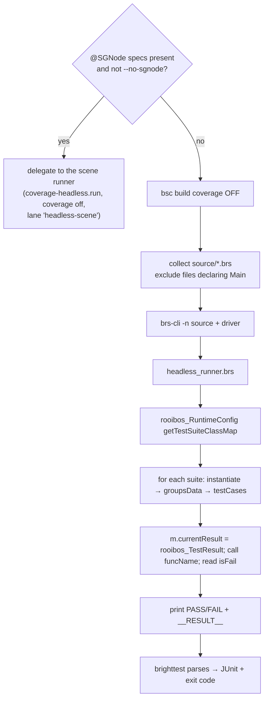

# Maintainer internals

For anyone hacking on brighttest itself. It's a small orchestration layer — no framework code of its own.

## Package layout

```
brighttest/
├── bin/cli.js               # arg parsing, lane dispatch, exit code (flag lanes + subcommands: e2e, instrument (incl. `instrument build --sideload`), device, devices, studio, mcp, doctor, assess, net, skills, init)
├── lib/
│   ├── config.js            # load brighttest.json; generate per-lane bsconfig (adds the instrument plugin for headless net)
│   ├── headless.js          # build (SceneGraph off) → drive on brs-node (async child, in-process hub) → parse → JUnit
│   ├── coverage-headless.js # build (coverage on) → stock Rooibos on brs-node → LCOV + node tests
│   ├── device.js            # build (coverage on) → stock Rooibos CLI under the lease → scrape LCOV
│   ├── cross-check.js       # run headless + device, diff the overlap for fidelity
│   ├── reporter.js          # shared console/JUnit reporter; laneFailures/treeFailures (results fail closed)
│   ├── e2e/                 # the on-device UI test lane (see "E2E lane" below)
│   ├── instrument/          # `brighttest instrument` (build [--sideload]/census/verify), the bsc plugin (plugin.js, receiver.js,
│   │                        #   rewrite-net.js, wrap.js), runtime/ (BT_* device code), the hub + net proxy/rules, greenfield/ templates
│   ├── mcp/                 # `brighttest mcp` stdio server (server.js, tools.js, net-window.js: session lease)
│   ├── spec-api/            # BrightScript helpers staged into spec builds on demand (BTState fixtures, BTMedia)
│   ├── studio/              # `brighttest studio` server (ECP, sgdebug, perf, Perfetto worker); client in studio/web (Svelte)
│   ├── device-lease.js      # device lease (+ device-command.js, device-hook.js, device-keepalive.js, devices.js): `brighttest device`
│   ├── doctor.js            # `brighttest doctor` capability check, hub bind check and opt-in hub reach probe; the e2e preflight
│   ├── assess.js            # `brighttest assess` read-only project report (reads through the census safe-read helper)
│   ├── engines.js           # brs-node / rooibos resolution (+ engine-caps.js, engine-run.js, `doctor --engines`)
│   ├── init.js, skills.js   # `brighttest init`, `brighttest skills` (install/update/export/list/uninstall, `--check` gate)
│   └── tools.js             # resolve dependency bins / plugin path regardless of hoisting
├── brs/headless_runner.brs  # the headless Rooibos driver (runs on the simulator)
├── docs/                    # this VitePress site (not published to npm)
├── experiments/             # spike scripts + device FINDINGS (not shipped) — see "E2E lane"
├── design/                  # older RFC notes kept in the repo: e2e-lane.md, studio.md (not shipped)
├── skills/                  # agent skills (shipped) + _always-on/safety.md, manifest.json, facts.json (`npm run skills:manifest`; `skills --check` gates claims against facts; the size gate grandfathers `writing-rooibos-tests/references/examples.md` (226 lines, over the 200 limit) until it is split, then drop `REF_LINES_GRANDFATHERED`)
├── scripts/                 # check-denylist, skills manifest + facts, audit gate, adopt-eval harness, docs-screenshots (Studio images for docs/guide/studio.md; needs Chrome; not shipped)
├── examples/                # sample-app, streaming-app, device-channel, greenfield-app, greenfield-skeleton, legacy-app,
│                            #   bsconfig-plugin-app, store-fixtures-app (not shipped; see docs/guide/examples.md)
└── package.json             # deps: @ramonlobo/brs-node, @ramonlobo/rooibos-roku, brighterscript, jszip
```

Only `bin`, `brs`, `skills`, `lib/*.js`, `lib/e2e`, `lib/instrument`, `lib/mcp`, `lib/spec-api`, `lib/studio/*.js`,
`lib/studio/public`, `README.md` and `LICENSE` are in the `files` array (`test/package-files.test.js` checks that every
relative `require` under `bin/` and `lib/` is in the pack), so `docs/`, `experiments/`, `design/`, `examples/`,
`scripts/` and `test/` **do not ship to npm** — they're repo-only. Design working notes, research and decision records
are kept outside the repository; the reasoning that matters to contributors is summarised in
[Design decisions](/decisions-summary).

## Delivery model

brighttest depends on two **published, scoped fork packages** that carry the engine and framework changes
which make headless SceneGraph testing work:

- **`@ramonlobo/brs-node`** — the brs-engine simulator with the SceneGraph field-fidelity fixes.
- **`@ramonlobo/rooibos-roku`** — Rooibos with the headless + resilient-device support, global-context
  seeding, and the `@deviceOnly` annotation.

A plain `npm i -D brighttest` pulls both from npm — there is **no vendoring, no `patch-package`, and no
postinstall step**. Each package is an exact upstream release tag plus a short, ordered queue of patches (branch
`bt/<upstream-version>` in the fork), published as `<upstream-version>-bt.<N>`; brighttest pins the exact `-bt.N`
version. Each patch is written so it can be offered upstream as its own change (the local-only ones are not meant
for that). Whether and when to offer one is an owner decision, and nothing is sent upstream until the owner says so. A
patch that upstream later releases is dropped at the next rebase. brighttest also runs on stock `brs-node` /
`rooibos-roku` (`engines` config or `BRIGHTTEST_ENGINES`); features that need a missing patch are detected at startup
and fall back or are skipped with a message, and `doctor --engines` says which build it found (see
[Engines and patches](/guide/engines)).

To change engine behavior: write the patch in a worktree of the fork
([Ramon-Lobo/brs-engine](https://github.com/Ramon-Lobo/brs-engine),
[Ramon-Lobo/rooibos](https://github.com/Ramon-Lobo/rooibos)) on its own branch, add it to the `bt/<version>` queue,
publish `-bt.<N+1>`, and bump the exact pin here. Offering a patch upstream (issues, pull requests) is a separate step
that the owner decides; it is not part of this workflow. The eventual goal is to depend on the stock packages.

::: warning One patch is non-device
`Label.forceUpperCase` (patch `BRS-02`) exists only in the patched headless engine; a real Roku has no such field and
the patch is not meant for upstream. `doctor --engines` marks it `NON-DEVICE` and headless runs warn on each use. Do not
let specs or shipped code depend on it. Details: [Engines and patches](/guide/engines#non-device-behavior).
:::

::: warning Historical sections below
The sections on `patch-package` and vendored `brs-node` bundles describe the **pre-publication** model.
Those fixes now live in the fork sources and ship inside the published packages above — brighttest no
longer patches or vendors anything at install time. They're kept for context on *what* the fixes were.
:::

## Dependency resolution (`tools.js`)

`resolveBin(pkg, binName)` and `resolvePackageMain(pkg)` use `require.resolve` with
`paths: [process.cwd(), __dirname, ..]`, so the toolchain resolves whether it's hoisted into the
consumer's `node_modules` (published install) or nested under brighttest (local `file:` link). The Rooibos
plugin is passed to `bsc` as an **absolute path** for the same reason.

## Config generation (`config.js`)

`writeBsConfig(cfg, lane, extra)` writes a bsconfig into `<stagingDir>/<lane>/bsconfig.json`:

- both lanes: `plugins: [<abs path to rooibos-roku>]`, `testsFilePattern`, source globs.
- headless: `isRecordingCodeCoverage: false`.
- device: `isRecordingCodeCoverage: true`, `createPackage: true`, and `printLcov: true` when `--lcov`.
- both lanes also set **`failFast: false`**. Rooibos's `failFast` defaults *on* in this build, which means
  one failing suite silently halts every suite that sorts after it (we hit this: a widget suite with 8
  failures hid 71 passing tests and dropped coverage from ~26% to ~2%). A runner must run everything.
- `diagnosticFilters` = `[1107]` merged with any codes from `brighttest.json`'s `diagnosticFilters`. 1107
  (redundant `<script>`) is always silenced because `autoImportComponentScript` makes it noise. Projects
  add more as needed — common ones for `@SGNode` specs: **1140** ("cannot find function") when a spec calls
  the component's own subs (they resolve at runtime inside the generated node but not in the spec's static
  scope), and **1002** (arg-count) for app code the device compiler tolerates.

## Headless lane

The default lane (`headless.js`) picks one of two execution strategies:



- **SceneGraph-off fast driver** (no node specs, or `--no-sgnode`): `brs-cli -n` + `headless_runner.brs`.
  The driver reuses Rooibos's **own** `BaseTestSuite` assertions and `TestResult`; only the scene-based
  `TestRunner` is replaced. That's why headless and device results are identical. It honors
  `setupFunctionName` / `beforeEachFunctionName` / `afterEachFunctionName` / `tearDownFunctionName` and
  supports `@params` arity 0–6. It **cannot** host `@SGNode` suites (no scene), so it skips them.
- **Scene runner** (node specs present): delegates to `coverage-headless.run(cfg, { coverage: false })`,
  which boots a real SceneGraph scene via the stock Rooibos runner (lane `headless-scene`) so `@SGNode`
  suites — including `onChange` cascades — run. Same code path as `--coverage`, minus LCOV. `--no-sgnode`
  forces the fast driver instead (and, on scene lanes, negates node specs out of the build).

## Device lane (`device.js`)

- The rooibos CLI runs as an **async child under the lease** (`lease.spawn`, in its own process group and recorded in
  the lease, so a crash of brighttest never leaves it running unaccounted for). Never `spawnSync`: the lease heartbeat
  and deadline timers must keep running.
- Output is streamed line by line through the shared reporter (`makeReporter` + `lineSplitter`) and kept for parsing;
  failures are counted with `laneFailures` (streamed cases, summary, report tree).
- With `--lcov`: LCOV comes from the console through `extractLcov(output)`, or from `--coverage-dir` (below) when the
  console has none:
  - accumulate `TN:/SF:/DA:\d+,\d+/LF:\d+/LH:\d+` into a record until `end_of_record`;
  - drop records whose `SF:` path matches `(^|/)rooibos/` (framework-injected);
  - join and write to the `--lcov` path.
- `extractLcov` is exported for unit testing.
- Fallbacks: one best-effort Home key press (through the ECP key path) runs after the lease is held and
  before deploy; a failed Home only warns. The watchdog (`--timeout`) kills the CLI's process group and the run
  fails even if the child never closes. No `[Rooibos Result]` is a failure, even when cases streamed. An idle (output-silence) watchdog
  (`--idle-timeout <sec>`, else config `deviceIdleTimeout`, else 120 s; `0` disables; an explicit value is also passed to the rooibos CLI as `--idle-timeout`, unset leaves its argv unchanged) kills the CLI if the device prints nothing; it sits
  above the rooibos CLI's own 90 s `[roku-test] no device output for Ns` exit. Aborted runs get typed messages: a stall
  reads "run aborted: no device output for Ns (idle watchdog)"; the `Brightscript Debugger>` prompt reads "run aborted by
  runtime error in `<suite>`" (suite from the last streamed suite header). Known limit: a stock-rooibos `@async` test that
  never calls done prints `[Rooibos Result]: PASS` after about 5 s, which the lane cannot tell from a real pass (the
  device is not silent); catching it needs an opt-in idle flag in the rooibos fork. When the rooibos CLI supports
  `--coverage-dir` (`supportsFlag` in `engines.js`: stamp `flags`, else rooibos >= 5.17.0), `--lcov` also passes
  `--coverage-dir=<staging>/device/coverage`; console lcov is preferred, and `<dir>/lcov.info` (run through
  `extractLcov`) is read only when the console yields nothing.

## E2E lane (`lib/e2e/`)

A separate, self-contained subsystem from the Rooibos lanes: it drives a **running** app on a real device
over stock ECP and asserts on the live SceneGraph. No brs-node, no Rooibos, **no new runtime deps** — only
core `fs`/`path`/`crypto` + global `fetch`. User-facing docs are under [E2E](/e2e/); this is the internals.

### Module map

| Module | Role |
|---|---|
| `ecp.js` | ECP driver: `launch`/`keypress`/`text`/`deviceInfo`, and dev **screenshots over HTTP Digest** (hand-rolled with `node:crypto` — `fetch` has no digest — + a manual multipart body) |
| `sgnodes.js` | fetch `query/sgnodes/all` with retry/backoff on render-thread RPC timeouts; settle-wait; tolerant XML→tree parser; typed errors (`LIMITED_MODE`, `CHANNEL_NOT_RUNNING`) |
| `select.js` | selector matching over the parsed tree (`id`→`name=`, subtype, text, uri, index, filters) |
| `navigate.js` | focus path-finding: geometry-driven D-pad loop with edge/convergence guards |
| `flow.js` | YAML-subset parser → shared step model, line-referenced errors (no `yaml` dep) |
| `run.js` | the lane: preflight, `buildPlan` (matrix × device sharding), per-device `runHost`, step exec, reporting, exit codes; `parseTargets` resolves per-host passwords |
| `record.js` | interactive TTY recorder → scaffolds a flow (`Recorder` is pure/testable) |
| `stamp-ids.js` | build-time `id` injection — a **bsc plugin** (`beforeFileParse` rewrites component XML) + a source transform |
| `ecpq.js` | per-host ECP call queue: per-endpoint spacing and one transient retry |
| `ready.js` | launch readiness gate (active-app, `sgnodes` answering, settle) |
| `reset.js` | device reset to a known state before a run |
| `appstate.js` | read an app's self-published state snapshot from a node's `text` attribute |
| `net-steps.js` | net fault/fixture flow steps (rules from `lib/instrument/net-rules.js`) |
| `state-steps.js` | `waitForAgent`/`setState`/`snapshot`/`restore`/`callFunc` flow steps through the hub |
| `hub-events.js` | per-run hub events file (NDJSON); agent event data allow-listed to `id`, `seq`, `op`, `ok`, `error`, `phase` |
| `logs.js` | telnet `:8085` log capture for a run |
| `lint.js` | static flow lint (warnings only) |
| `assert-builder.js` | turns a live node into ready-to-paste flow assertions (`e2e inspect`) |
| `video.js` | optional `--video`: assemble per-step screenshots into mp4/gif via **ffmpeg** (external, optional; skipped with a note if absent) |

The pure parts (parser, selector, navigator algorithm against a simulated grid, recorder, id-stamper, run
planner, digest/multipart helpers) are unit-tested under `test/e2e*.test.js`; device behaviour is validated
on a real Roku.

### Device/ECP facts that shaped it {#e2e-device-facts}

These were established on real hardware (Roku Ultra; first on fw 15.2.4, and partly re-confirmed on 16.0.4 build 853 in the 2026-11-19 batch: custom fields not dumped, `Group` dumped as `RenderableNode`, `Channel not running` on Home, the 8085 debugger freeze) and are recorded in
`experiments/FINDINGS.md`, `experiments/VIDEO-FINDINGS.md`, and `design/e2e-lane.md`. A maintainer touching
this lane should know them:

- **A node's `id` is serialized as the `name=` attribute** in `sgnodes`, and **custom fields are not
  dumped at all** — so a dedicated `testId` is invisible. The only reliable named hook is the built-in
  `id` (matched as `name=`); `stamp-ids.js` injects `id`, never a custom field.
- **ECP Network access must be Permissive** (Settings → System → Advanced → Control by mobile apps) or
  `sgnodes`/`keypress` are refused (`Limited mode` / HTTP 403). The lane preflight surfaces this.
- **`sgnodes` is a render-thread RPC**: it times out when the thread is busy (retry+settle) and fails with
  `Channel not running`/`not ready` right after launch (waited out). A **crash drops the app into the
  BrightScript debugger, which pegs the render thread** → every `sgnodes` read then times out; if you see
  persistent timeouts, telnet `:8085` for a runtime error, not a lane bug.
- **Screenshots cap at ~1 fps** (dev endpoint: generate + digest fetch ≈ 1.1s). Hence `--video` is an
  assembled slideshow, not motion capture; true video needs external HDMI capture.
- **`Lit_` text must be URL-encoded exactly once** — a space double-encoded to `Lit_%2520` returns 400
  (letters are unaffected, which masks it). `ecp.text()` passes the raw char; `keypress()` encodes once.
- **Render-thread components cannot call `pkg:/source` globals** (`func_name_resolver` fails → &h91). Share
  code with a component via an explicit `<script>` include, not a source global. (The sample app keeps a
  local `clamp` for this reason.)
- **Relaunching a running channel does not reset its scene**, and a `Keyboard` **persists its text** across
  relaunches. Flows should drive to a known state (e.g. a Back-to-Home preamble) rather than assume it.

### Multi-device & the app-vs-test-build split

- `run.js` runs one device per host in parallel; a single host streams live, multiple buffer per device and
  flush in host order. `parseTargets` accepts `--host ip:pw,ip2:pw2` so a mixed-password fleet can capture
  screenshots (ECP navigation needs no auth; the screenshot endpoint does).
- The e2e lane **does not build/deploy** — it assumes the app is already sideloaded. For a project that also
  has Rooibos specs, the app build for e2e must be plain `.brs`/`.xml` and **exclude `main.brs` from the
  Rooibos test build** (Rooibos owns the entry; the app's `Main()` would hang the runner). See the
  [sample app](https://github.com/Ramon-Lobo/brighttest/tree/main/examples/sample-app) and its README,
  which encode these constraints as working patterns and are the place to extend as the lane grows.

## Instrumentation internals (`lib/instrument/`)

User docs: [Instrument](/guide/instrument). The pieces, in data-flow order:

| Module | Role |
|---|---|
| `census.js` | What the plugin will touch; also the **safe-read helper** used by `assess` (`O_NOFOLLOW`, fd dev/ino vs `lstat`, size cap, refusal reasons, never `.env`/keys/certs, effective root from `rootDir`) |
| `build.js` | One fresh bsc `Program` per build on a staged copy; writes the package to a temp path and moves it to `--out` only after every gate passed |
| `plugin.js` | The single bsc plugin: Scene bootstrap, `BT_Agent` injection, `BT_op` on components, net call-site rewrite, dispatch/Task wraps, report kinds (strict ones fail with `--strict`) |
| `rewrite-net.js`, `receiver.js` | `setUrl(x)` → `setUrl(BT_url(x))`, `getUrl()` → `BT_unurl(getUrl())`; receiver classification (confirmed / likely / unknown / excluded) |
| `wrap.js` | Renames a config-named function to `__bt_orig_<name>` and appends a wrapper with the original name and defaults |
| `runtime/` | The injected BrightScript (staged with full-line comments and blank lines stripped; explanations live in `runtime/README.md`) |
| `verify.js` | Release gate: exit 3 when a package carries any marker |
| `sideload.js` | Installs under the lease through the dev installer; the password is never printed |
| `hub.js`, `state-ops.js`, `events.js` | The hub: routes under `/bt/<token>/`, peer and token checks, long-poll command channel, state command machine, 64 KB limits |
| `net-proxy.js`, `net-rules.js`, `net-ctl.js`, `net-headless.js`, `net-convert.js` | Mock / sequence / fault / passthrough / record, rule matching and redaction, the `BTNet_*` control API, the headless session, HAR to rules |

Rules a change here must keep:

- **Plugin order.** The instrument plugin runs **after** the Rooibos coverage processor (`assertPluginOrder()`), or the
  Scene `init` wrapper hides a line from coverage. Do not "fix" this by delegating the walk.
- **Same-line rewrites.** Rewrites reuse the original range and add no newline, so line numbers in crashes and coverage
  stay true.
- **Fail closed with a report.** Anything the plugin cannot rewrite safely is reported (`wrap-target-unknown`,
  `net-render-thread`, inline CDATA Scenes) rather than guessed.
- **Size budget.** A test builds the real package and holds `source/bt` + `components/bt` to at most 1,500 lines and
  60,793 bytes. Put explanations in `runtime/README.md`, not in shipped code.
- **Redaction on every read layer.** New layers or ops route through the same redaction lookup (`BT_wRedSeg`) so
  secret-looking keys and `redact.paths` are masked on the agent's `get` and snapshot reads before data leaves the app.
  Action-log payloads are masked by key name on the device and by `redact.paths` on the host. Studio's `raw=1` views and
  a fixture saved with `raw: true` skip the host-side masking by design (the agent's own masking still applies).
- **Hub refusals give no oracle.** Wrong peer, wrong token or unknown route: empty 404. Lost lease: 423. The hub runs
  in-process, so never `spawnSync` a child that talks to it.
- **The hub address has one source** (`instrument.hub.host`/`port`, default this machine's LAN IPv4 and 8790), read by
  both the build and the run; `auto` is never baked.

## Device lease internals (`lib/device-lease.js`)

User docs: [Device lease](/guide/device-lease). Lock files under `~/.brighttest/leases/<key>/` (override
`BRIGHTTEST_LEASE_DIR`): `holder.json` (created with `link()`, so readers never see a partial file), FIFO tickets in
`queue/`, and a `reclaim.lock/` mkdir mutex around every delete of `holder.json`. Interface:
`acquire`/`release`/`withLease`/`status`, so a broker could implement the same contract later.

- Command leases record the holder PID; a dead PID is reclaimed. Session leases record `pid: null` and expire on
  `sessionIdle` or `sessionMax`; a token re-enters without queueing.
- Hygiene (Home ×2, `deviceLease.hygiene`, `--no-hygiene`) runs on acquire for `e2e run`, `device with` and
  `device lock` only (`acquireForLane({ hygiene: true })`). The Rooibos device lane presses Home once before deploy;
  Studio, MCP, `e2e inspect`/`record`, `device reset` and sideload pass `hygiene: false` or never ask for it.
- Re-entry skips hygiene; `e2e/run.js` runs it when it starts a hub under a re-entrant lease.
- `lib/mcp/net-window.js` holds one session lease for the MCP net window, re-enters it for device tools, checks it
  periodically and closes a margin before the record could expire.
- `device-keepalive.js` allows only `Fwd`, default 240 s, minimum 60 s, and stops after three failures in a row.
- `device-hook.js` is a syntactic guard: any internal failure allows (a broken guard must not brick a session).
- Exit codes 75 (busy/timeout), 77 (lost/expired), 78 (lease directory) are exported and gated in `skills/facts.json`.

## Type checking (`tsconfig.json`, ADR 0043)

The code stays plain CommonJS with no build step. TypeScript is a dev-only checker: `typescript` and `@types/node` are
devDependencies, nothing is emitted, and nothing changes at runtime or in the published package.

- `npm run typecheck` runs `tsc -p tsconfig.json` and `tsc -p tsconfig.strict.json`.
- `tsconfig.json` has `allowJs`, `checkJs: false` and `noEmit`, so a file is checked only when it starts with
  `// @ts-check`. Opt a file in, run the command, and fix what it reports with JSDoc (`@param`, `@typedef`) or small
  type-only comments. Do not change behaviour to satisfy the checker.
- `tsconfig.strict.json` extends it and adds `strictNullChecks` for the files listed in its `files` array (empty for now).
- Today `lib/mcp/tools.js` and `lib/instrument/events.js` are opted in as smoke files.
- CI runs the `typecheck` job on Node 22. It is non-required until the rollout reaches phase A3.

## Skills and the facts gate (`lib/skills.js`)

`npm run skills:manifest` regenerates `skills/manifest.json` and `skills/facts.json` (CLI version, subcommands, flags,
exit codes, defaults, skill and agent lists). `brighttest skills --check` fails on facts drift and on skill text that
contradicts the facts (Node claims, skill lists, subcommands in shell fences, exit codes, defaults, banned claims, size).
The installer validates manifest entries and refs, refuses path escapes, writes atomically, manages a marked safety block
in the agent's always-on file, migrates retired skills, and merges the guard hook and MCP entry only with
`--with-hook` / `--with-mcp`. Run the manifest script after any change to skills, the version, a dependency range, a
CLI flag or help text, or a lease or instrument default.

## Rooibos coupling & upgrade risk

The headless driver depends on Rooibos's compiled shape: the `RuntimeConfig` suite map, `suite.groupsData`,
`testCase.funcName`/`rawParams`, and `rooibos_TestResult` / `BaseTestSuite` semantics. These are stable
across current Rooibos 5.x but are **internal**, not a public API. When bumping `rooibos-roku`:

1. Run the headless lane against a known suite and confirm counts match the device lane.
2. If the suite metadata shape changed, update `headless_runner.brs`.
3. If the LCOV console format changed, update `extractLcov` in `device.js`.
4. If the summary or report-tree format changed, update `parseSummary`, `treeFailures` and `laneFailures` in
   `reporter.js`. The run fails when any of streamed cases, summary failed+crashed, or report-tree FAIL/CRASH entries
   is non-zero (the largest of the three, never the sum); `treeFailures` also matches names that Rooibos truncates to
   fit its column. This guards against framework paths that drop a crash from the summary; the real fix for such a path
   belongs in the fork.

## `@SGNode` headless patch {#sgnode-headless-patch}

::: warning Historical
This section describes the pre-publication model. `patch-package`, `patches/`, `lib/patch-brs-node.js`, `vendor/` and the `postinstall` hook no longer exist in this repo; the fixes now ship in the forks. See [Delivery model](#delivery-model).
:::

This is the mechanism that lets `@SGNode` node suites run **headless** (in the `--coverage` lane and, by
extension, `--cross-check`). It's a two-hunk patch to `rooibos-roku`, which was applied
by patch-package on install. It now lives in the `@ramonlobo/rooibos-roku` fork queue (see
[Delivery model](#delivery-model)); the `patches/` file no longer exists.

### Root cause

Rooibos runs a node test by creating the generated `<Node>_component`, then waiting for its
`rooibosTestResult` field. Inside the node, the suite runs through Rooibos's **promise library**
(`rooibos_promises`): each async step is a `roSGNode` "promise" with a `promiseState` field, and listeners
are notified when that field changes — via `observeFieldScoped(promise, "promiseState", <callback-name>)`.

The callback name Rooibos passes is the *stringified anonymous function* (`callback.toStr()` → tokens →
`$anon_N`). **brs-node's `observeFieldScoped` returns `false` for an anonymous-function name and never
registers the observer.** So on the simulator the promise's `promiseState` changes but *nothing is
notified* — the promise chain never advances, `testSuiteDone` is never called, `rooibosTestResult` is never
set, and `runNodeTest` eventually logs *"did not indicate test completion"*. The suite hangs / is dropped.
(On real hardware the observer registers fine, so node tests always worked on `--device`.)

### The fix (two hunks)

**1. `rooibos_promises/promises.brs` — settle promises directly, not via the field observer.**
A new `rooibos_promises_internal_notifyPromise(promise)` does exactly what the observer callback used to do
(unregister, drain `then`/`catch`/`finally` listeners, re-run for listeners added during callbacks), but is
called **synchronously** from `resolve()`, `reject()`, and the already-settled branch of `internal_on()`.
The original observer-driven `internal_notifyListeners` now just delegates to it. This makes promises settle
in *every* environment without depending on `observeFieldScoped`. On device the still-registered observer
later fires but finds the storage already cleared → harmless no-op.

**2. `rooibos/TestRunner.bs` — `runInNodeMode` returns the result.** With hunk 1, the promise chain now
settles *synchronously inside* `testSuite.run()`, so `testSuiteDone` sets `rooibosTestResult` *before*
`run()` returns. But the generated node does `m.top.rooibosTestResult = nodeRunner.runInNodeMode(...)`, and
`runInNodeMode` was declared `as void` — so its `invalid` return value would immediately **overwrite** the
real result. The fix changes the signature to `as dynamic` and returns
`{ stats, tests, groups }` from the success path (and `return invalid`, not a bare `return`, from the
failure path — the **device** compiler rejects a bare `return` on a non-`void` function with
`Return must return a value`; brs-node is lenient, so this only surfaces on hardware).

### Why this is safe on device

Both lanes share the patched `rooibos-roku`, so the patch **must not regress the device lane.** It doesn't:
direct notification produces the same listener ordering, the leftover observer is a no-op, and
`runInNodeMode` now returns the same result the node already published. Verified: `--device` and
`--coverage` both report **76/76** on this project (incl. the Theme node suite), and `--cross-check` shows
**0 divergent**. Always re-run all three lanes after touching this patch.

### Scope

This patch makes node suites *run and settle* headless. On its own it doesn't make `onChange` handlers
fire — that's the separate [brs-node patch](#brs-node-onchange-patch) below. Together they give full
`@SGNode` fidelity headless (ButtonEx: **95/95, 0 divergent** vs device). What remains device-only is
behaviour tied to real wall-clock render timing — animations playing out over frames and live remote
input. `Task` run loops block `@SGNode` tests, so Task logic is tested as pure functions. Headless HTTP is
mocked by brighttest itself: it rewrites `roUrlTransfer.setUrl` call sites to a loopback server driven by
`instrument.net.fixtures` or the per-test `BTNet_` spec API, with no fork hook involved (see
[HTTP fixtures](./writing-tests/http-fixtures.md)); it is headless-only, so `BTNet_` specs are skipped on `--device`, and
requests that bypass a rewritten `setUrl` are not covered. The device lane is the fidelity reference
for render timing and remote input; `--cross-check` polices the line.

## brs-node `onChange` patch {#brs-node-onchange-patch}

::: warning Historical
This section describes the pre-publication model. `patch-package`, `patches/`, `lib/patch-brs-node.js`, `vendor/` and the `postinstall` hook no longer exist in this repo; the fixes now ship in the forks. See [Delivery model](#delivery-model).
:::

The companion to the rooibos patch. It lives in `lib/patch-brs-node.js` (an idempotent postinstall script,
**not** a patch-package patch — see [why](#why-a-script-not-patch-package)) and makes XML `onChange`
handlers fire during headless node tests.

### Root cause

brs-node batches SceneGraph field-change notifications. Setting a field calls `notifyObservers()`, which
normally queues the field and runs `flushNotificationQueue()` — but that flush is guarded by a static
`flushingNotifications` flag. Rooibos runs an **entire node suite inside one flush** (the suite is kicked
off by the `rooibosRunSuite` field observer, i.e. from within `dispatchObservers`). So every field a test
sets is *nested* inside that flush: `flushNotificationQueue()` early-returns, the field just sits on the
queue, and its `onChange` fires only after the whole suite ends — far too late for the test's assertions.

Net effect before the patch: `onChange` cascades (padding fan-out, text mirroring, focusPercent cross-fade,
disabled dimming) never ran headless — 87/95 with 8 observer tests failing, all flagged divergent by
`--cross-check`. Neither `m.wait()` nor an `@async` test helped: pumping the message loop doesn't drain the
*nested* queue (proven with a three-variant probe).

### The fix

One-line change to `notifyObservers` in the minified SG bundle (`brs-node/bin/brs-sg.node.js`): when a set
happens **while a flush is already in progress**, dispatch that field's observers **synchronously** instead
of queuing them:

```
// nested set → fire now, like real Roku's same-thread onChange
y.flushingNotifications ? this.dispatchObservers()
                        : (queue field; flushNotificationQueue())
```

This mirrors real hardware, where a same-thread field set fires `onChange` synchronously. Recursion is
bounded by brs-node's own per-observer `running` guard (a handler that re-sets its own or a mutually
observed field is skipped while already running), so cycles terminate the same way they would on device.

### Why it's safe

Blast radius is **headless only** — the device lane uses real hardware, not brs-node. It makes the
simulator *more* device-faithful, not less. Verified: the 87 non-observer tests still pass, the 8 observer
tests flip to pass, coverage rose 26% → 34% (the handler code now actually executes), and `--cross-check`
went to **0 divergent**. Re-run all three lanes after touching it.

## brs-node `roTextToSpeech` bundle {#brs-node-createobject-patch}

::: warning Historical
This section describes the pre-publication model. `patch-package`, `patches/`, `lib/patch-brs-node.js`, `vendor/` and the `postinstall` hook no longer exist in this repo; the fixes now ship in the forks. See [Delivery model](#delivery-model).
:::

The third fix. Unlike the string-patches, this replaces the **core bundle** `brs.node.js` with a rebuild of
brs-node@2.2.0 that implements the `roTextToSpeech` component. `lib/patch-brs-node.js` copies the vendored
bundle (`vendor/brs-node/brs.node.js`) into `node_modules/brs-node/bin/` on postinstall (version-gated to
2.2.0). `brs-sg.node.js` delegates its component registry to `brs.node.js`, so swapping the core bundle
covers the SceneGraph lane too.

### Root cause

brs-node is a simulator and doesn't implement `roTextToSpeech`, which some apps create from a shared
audio-guide helper on most focusable widgets' init/focus path. `CreateObject` returns `invalid` for the
unknown class (brs-node@2.2.0 already does this — source `CreateObject.ts` returns `BrsInvalid.Instance`),
then the widget derefs it (`m.tts.say(...)`) → a fatal `EXIT_BRIGHTSCRIPT_CRASH` during node *init*, which
is uncatchable and aborts the whole run. Verified against a large production app: `roTextToSpeech` was the
**only** class it instantiated that brs-node lacked (roSGNode/roSGScreen are in the SG bundle).

### The fix

Implemented a headless `RoTextToSpeech` component in the brs-engine source
(`src/core/brsTypes/components/RoTextToSpeech.ts`, registered in `BrsObjects.ts`) and rebuilt the minified
bundle (`npm run release --prefix packages/node`). It's a functional no-op: no audio, `IsEnabled()` returns
false (so callers that gate speech on it cleanly skip), `Say`/`Silence` return an incrementing request id,
`Flush`/voice/language methods are no-ops. Widgets that create it now instantiate and run headless instead
of crashing. Verified: ButtonExGroup went from a hard TTS crash to **16/0 headless**; a 7-widget TTS batch
had 6 widgets instantiate and run (35 pass) where all previously hard-crashed.

### Source & rebuild (to regenerate the vendored bundle)

- Source clone: `Roku/brs-engine` (lvcabral/brs-engine) checked out at tag `v2.2.0`.
- The class: `src/core/brsTypes/components/RoTextToSpeech.ts` (+ one import and one registry line in
  `src/core/brsTypes/components/BrsObjects.ts`).
- Build: `npm install` then `npm run build:api && npm run release --prefix packages/node` → produces
  `packages/node/bin/brs.node.js` (minified). Copy it to `brighttest/vendor/brs-node/brs.node.js`.
- **Preferred long-term:** upstream `RoTextToSpeech.ts` as a PR to lvcabral/brs-engine; once released, bump
  `brs-node` and delete the vendored bundle + this install step.

### Remaining limitation (not TTS)

Implementing roTextToSpeech does **not** fix components whose `init()` needs real field context that a bare
Rooibos node doesn't provide (e.g. a dialog whose `init()` derefs a not-yet-built child, or a Type Mismatch
from an unset field). Those still crash node creation and must be handled per-component (wrapper/field setup) or
run on `--device`. Many widget *tests* also crash per-test (caught) when they exercise methods needing
context — a test-authoring concern for the fix pass, not a platform gap.

### Why a script, not patch-package {#why-a-script-not-patch-package}

The brs-node bundles are 370 KB **single minified lines**. patch-package uses line-based diffs, so a
one-token change would embed the entire line twice (~750 KB) in the patch. `lib/patch-brs-node.js` instead
applies **both** brs-node patches (onChange in `brs-sg.node.js`, CreateObject-tolerance in `brs.node.js`) as
targeted, **idempotent**, version-aware string replacements: each no-ops if already applied, and if a target
string isn't found (brs-node changed) it prints a warning and exits 0 — **never failing `npm install`**.
The `postinstall` hook runs it after patch-package: `patch-package && node lib/patch-brs-node.js`. If you
bump `brs-node`, re-verify the `FIND` strings still match and re-run the lanes.

### patch-package mechanics {#patch-package-mechanics}

- `patches/rooibos-roku+5.16.4.patch` (removed from this repo) was generated with `npx patch-package rooibos-roku` after editing the
  files under `node_modules/rooibos-roku/dist/...`.
- `"postinstall": "patch-package"` re-applies it on every `npm install`, so a fresh install of the pristine
  package is re-patched automatically. `patches/` is in the `files` array so it ships with the package.
- To change the patch: edit the files in `node_modules/rooibos-roku/`, re-run `npx patch-package
  rooibos-roku`, then re-verify all three lanes.
- **Version pinning:** the patch filename encodes `5.16.4`. If you bump `rooibos-roku`, patch-package will
  warn that the patch doesn't match; regenerate it against the new version (and re-check the two hunks still
  apply — the promise library and `TestRunner` are internal and can move).
- **Distribution caveat:** patch-package patches a package's *own* `node_modules`. When brighttest is
  installed as a dependency and its deps are hoisted, the postinstall may not find the nested
  `rooibos-roku` to patch. This works cleanly for local/`file:` development (our current setup). For robust
  distribution the real fix is [Option A below](#alternatives-if-we-revert) (upstream PR) — decide before
  publishing.

### Alternatives if we revert {#alternatives-if-we-revert}

If the patch ever needs to be backed out, here are the fallbacks, in order of preference:

- **Option A — upstream PR (best).** Send hunk 1 (the anonymous-observer fix) to `rokucommunity/rooibos`;
  it's a genuine brs-node-compat bug and helps everyone. If merged, drop the patch entirely and bump the
  dep. Hunk 2 may not be needed upstream (it exists to cope with hunk 1's synchronous settling in the
  generated-node flow) — evaluate at PR time.
- **Option B — gated `runSync`.** Instead of fixing the promise dispatch, force node suites to run
  synchronously *only* under the headless-coverage lane: detect the simulator and have the node runner call
  a synchronous run path (drain groups/tests inline) rather than the promise-based async loop. Downsides we
  hit when prototyping this: it forces **all** node tests synchronous (breaks genuinely async node tests),
  it broke stats aggregation (counted 71 not 76 because merged node stats bypassed the normal path), and
  `runInNodeMode`'s `void` return still had to be worked around. It's strictly worse than the promise patch
  for correctness, but it's the fallback if hunk 1 ever proves unsafe on some device. Keep it **gated to the
  simulator** so the device lane is untouched.
- **Option C — accept device-only node tests.** The pre-patch behavior: skip `@SGNode` in `--coverage`,
  run them only on `--device`. `config.js` used to exclude node specs from the headless-coverage build via
  `findNodeSpecs()` negation globs — that's the code to restore. Simplest, but loses headless node testing.

## Device-free tests: fake-roku and fake-origin {#device-free-tests-fake-roku-and-fake-origin}

Two zero-dependency stubs under `test/fixtures/` let the integration tests (and a person at a terminal) exercise the device
lanes with no Roku. Both use placeholder identifiers only and bind to loopback by default. They are repo-only fixtures: they
do not ship to npm and no test run should treat them as device evidence.

**`test/fixtures/fake-roku/`** is a scripted stub Roku (ECP, dev installer, the 8080 console and the 8085 debug log).

```sh
node test/fixtures/fake-roku/server.js --list                       # scenario names
node test/fixtures/fake-roku/server.js --scenario healthy --log fake.jsonl
node bin/cli.js doctor --host 127.0.0.1 --ecp-port 8060             # point brighttest at it
node bin/cli.js e2e run test/fixtures/fake-roku/flows/fake-smoke.e2e.yaml --host 127.0.0.1 \
  --ecp-port 8060 --password rokudev-test --screenshots-mode off
```

- Scenarios (`--list`; this is a summary, run it for the complete set, which also includes `keypress-home-500` and `keyup-fails`): `healthy`, the ECP faults (`latency-200ms`, `5xx-once`, `5xx-always`, `reset-once`, `stall`, `401`,
  `403`, `404`), device states (`limited`, `dev-disabled`, `unreachable`, `halted-app`, `never-leaves-home`), launch and
  install behaviour (`home-bounce`, `launch-404-after-sideload`, `installer-page`, `installer-500`, `crash-mid-flow`,
  `debugger-crash`, `replay-then-live`, `console-slow`), tree shapes (`osd-facade`, `system-dialog-root`, `large-tree-3k`,
  `large-tree-6k`, `focus-grid`, `late-node`), scenegraph query failures (`sgnodes-fails`, `sgnodes-hangs`, `cold-stall`)
  and Rooibos transcripts (`rooibos-pass`, `rooibos-fail`).
- Ports: ECP 8060, installer 8090 (`--installer-port 80` mimics a real device but needs root; the default 8090 is enough for doctor and `e2e run`), console 8080, debug 8085; `--ecp-port`, `--installer-port`,
  `--console-port`, `--debug-port` override them and port 0 picks a free one. Point brighttest at a non-default ECP port with
  `--ecp-port` or `ROKU_ECP_PORT`.
- `--hub http://127.0.0.1:<port>`: on start, on `launch/dev` and on a `keypress/Info`, the stub fetches one URL through a
  brighttest hub, reading the token from `BRIGHTTEST_HUB_TOKEN`, and shows the body in a `Label netBody` (`netbody: error`
  on any failure). It never prints the token.
- The module API (`createFakeRoku`) and the full flag list, request-log format and tree contract are in
  `test/fixtures/fake-roku/README.md`; tests are in `test/fake-roku.test.js`.

**`test/fixtures/fake-origin/server.js`** is a fake HTTP origin (default `127.0.0.1:8787`; `--host`, `--port`, `--log`) with
`/home`, `/catalog`, `/search`, `/auth`, `/track`, `/echo`, and failure endpoints (`/slow?ms=`, `/stall`, `/reset`,
`/redirect`, `/large?kb=`, `/sse`). It redacts `Authorization` in its request log. The greenfield example app expects it at its default base
URL (`http://127.0.0.1:8787`).

## Deny-list check (`scripts/check-denylist.js`)

Guards against client references, secrets and identifiers reaching git history or pack reports. The term
list is **never in the repository**: put one term per line (`#` comments allowed) in a file outside the
checkout and point `BRIGHTTEST_DENYLIST` at it (default `~/.brighttest/denylist.txt`). Matching is
case-insensitive and word-ish (a term inside a longer alphanumeric word does not match); hits inside long
hash-like tokens (integrity hashes) are ignored. Output is `file:line  kind  masked-term`, never the term.

```sh
npm run check:denylist                          # tracked files
npm run check:denylist -- --staged              # added lines of the staged diff
npm run check:denylist -- --range origin/main..HEAD   # commit messages + diffs of a push range
npm run check:denylist -- --path <dir-or-file>  # arbitrary paths (pack reports, unpacked tarballs)
npm run check:denylist -- --json                # machine-readable
```

Exit codes: `0` clean, `1` hits, `2` configuration error. It fails closed: a missing list, an empty
list, or a list that git tracks is exit 2 (`--allow-missing` downgrades only the missing case to a
warning). Run it with `--range` before every push.

## Docs site

VitePress lives in `docs/` (excluded from the npm `files` list, so it isn't published).

```bash
npm run docs:dev       # local preview
npm run docs:build     # static site → docs/.vitepress/dist
npm run docs:preview   # serve the built site
npm run docs:a11y      # axe accessibility check of every built page, light and dark (needs Chrome; see the script header)
```

Mermaid diagrams render via `vitepress-plugin-mermaid`. Content is plain Markdown; the sidebar/nav lives
in `docs/.vitepress/config.mts`.

### Version switcher theme

`docs/.vitepress/theme/` extends the default theme with a version switcher (the `nav-bar-content-before` slot), a banner
(unreleased or older release) and a 404 body that offers the same page under `/next/` when it exists
there. At runtime the theme fetches `versions.json` from the site root (the build's base with its
`next` or `vX.Y` segment removed), finds its own entry by matching `site.base`, and hides all of it
when the file is missing or fails validation: `schema` must be `1`, each entry needs string `id`, `label` and a
`path` (and optional `alias`) that starts with the site root, ends in `/` and has no `//`, backslash, `:` or `..`,
and `latest` must name an entry. Any failure drops the whole file. The file is fetched once per page load. `npm run docs:dev` and a plain `docs:build` have
no `versions.json`, so the switcher and banner do not appear there. To preview them, build with
`BRIGHTTEST_DOCS_CHANNEL=next npx vitepress build docs --base /brighttest/next/ --outDir <scratch>/next`,
add a hand-written `versions.json` beside it in `<scratch>` and serve `<scratch>` under `/brighttest/`.
Setting `BRIGHTTEST_DOCS_CHANNEL=next` also adds `<meta name="robots" content="noindex">` so only
releases are indexed. The 404 body does not read `versions.json`: it probes for the same page under `/next/` with a `HEAD`
request and links to it when found. The root 404 page cannot know which version path was requested, so its switcher
shows a neutral "Versions" label and there is no banner.

### New and Updated badges

Pages get a "New" or "Updated" tag (page header and sidebar) between releases. The tag is text, not colour alone.

- **New:** the page exists in this build but not in the baseline release's page list. Renamed pages show as New.
- **Updated:** the page is linked from a line of the coming release's changelog section (`## Unreleased` on `/next/`,
  the build's own version section on a release build). A page that is New shows New only. To drop a wrong "Updated", edit
  or remove the link in `docs/changelog.md`; linking many pages makes many tags. The tag also shows in the prev/next pager at the bottom of a page.
- **Baseline:** the previous release. It comes from `docs/.vitepress/release-pages.json` (the last two releases' page
  lists), so builds need no git history or tags. The tags go away on their own when the next release is cut.
- **Where:** `/next/`, and the latest release (root and its `/vX.Y/` alias; `docs-site.js` passes
  `BRIGHTTEST_DOCS_LATEST=1` for those). Older minors show none, as do releases built before this feature existed.
  `docs:dev` and a plain `docs:build` show them. A missing or malformed data file means no tags and one log line, never
  a failed build.
- **Release step:** `node scripts/changelog.js stamp` also appends the working tree's page list to
  `release-pages.json` (`--no-pages` skips it); the `version` script stages it with `docs/changelog.md`, so there is nothing to stage by hand.
  To (re)create an entry from an existing tag: `node scripts/changelog.js pages --from-tag vX.Y.Z --write` (needs the
  tag locally).

## Publishing

`dependencies` (not devDependencies) list the runtime toolchain so a normal `npm i -D brighttest` pulls it
transitively (the two forks, `brighterscript` and `jszip`). Docs tooling (`vitepress`, `mermaid`) are devDependencies
and aren't shipped. For local development use `file:` linking and run `npm install` inside `brighttest/`
once so its `node_modules` is populated.

Changelog first. Every release needs a curated section in `docs/changelog.md`, and `npm version` and `npm publish` refuse to continue without one:

1. `node scripts/changelog.js draft --prs > /tmp/draft.md` prints a draft from the conventional commits between the latest tag and `HEAD`. It is raw material, never paste it as is.
2. Curate: move the useful lines into `## Unreleased` in `docs/changelog.md`, rewrite them for users, keep the breaking and security lines already there, and add upgrade notes. Aim for 10 to 30 lines on a normal release.
3. Commit it (`docs(changelog): ...`), then run `npm run skills:manifest` and `npm version <level>` as below. The `version` script runs `node scripts/changelog.js stamp`, which turns Unreleased into the new release section and leaves a fresh empty Unreleased; it aborts before any commit or tag when Unreleased has no entries. The stamped changelog and release page list are staged into the release commit. If `npm version` fails after the stamp (for example the empty-Unreleased abort), run `git checkout package.json package-lock.json docs/changelog.md docs/.vitepress/release-pages.json` before retrying, so the version is not bumped twice. The release workflow runs `node scripts/changelog.js check --version-env` and `check --tags` explicitly in its `verify` job, so a version with no changelog entry (or any lint finding) cannot be staged; `prepublishOnly` runs the same check only for a manual `npm publish`, which you should not do.
4. After pushing the tag, CI creates the GitHub Release as a draft from these notes (see Releasing); you only publish the draft.

Release flow: `skills/facts.json` carries `cliVersion`, so `npm version` alone leaves it stale. Run `npm run skills:manifest` after any version bump, dependency range change, CLI flag/subcommand/help change or lease/instrument default change, and commit the result (`brighttest skills --check` fails on drift). Releases go through the **Prepare release** workflow, which runs `npm version <bump> --no-git-tag-version` on a `release/vX.Y.Z` branch and opens a PR (a local `npm version` that commits and tags on `main` is no longer the flow); after merging, push the tag from `main`, so CI stages the package (see [Releasing](#releasing)). Do not run `npm publish` by hand.
`npm pack --dry-run --ignore-scripts` shows the tarball contents locally (build Studio first: `npm run studio:build`). `v0.3.0` was the first release carrying the e2e lane.

### Releasing

Releases are staged by CI and approved by a person. Pushing a `v*` tag runs `.github/workflows/release.yml`, which stages the package on npm. Nothing is live until the owner approves it with 2FA.

#### Steps

1. Curate `## Unreleased` in `docs/changelog.md` on `main` (see Publishing above).
2. Actions -> **Prepare release** -> Run workflow: pick `patch`, `minor` or `major` and tick `notes_ready`. It bumps the version without a tag, stamps the changelog, regenerates `skills/` facts and opens a PR from `release/vX.Y.Z`. It never tags or publishes.
3. Review and merge the PR. PRs opened with `GITHUB_TOKEN` do not trigger `pull_request` workflows, so the workflow also dispatches `test.yml` on the branch (best effort, not yet exercised on a real run). If the checks do not appear, push an empty commit to the branch or close and reopen the PR.
4. Tag the merged commit on `main` and push the tag: `git tag vX.Y.Z <sha> && git push origin vX.Y.Z`.
5. The Release workflow runs `verify` first, then `publish`. No environment approval is configured (the approval that matters is the npm 2FA one below); if you later add a required reviewer to `npm-release`, approve it here.
6. The `publish` job stages the tarball `verify` built and writes the stage id and these instructions to its job summary. Review it, then approve with 2FA: **Approve** in the Staged Packages tab on npmjs.com, or `npm stage approve <stage-id>`.
7. `github-release` has already created a **draft** GitHub Release. Read the notes and click Publish only after the package is approved.
8. Post-release checks: `npm view brighttest version`; in a scratch directory run `npm i brighttest && npx brighttest --version`; after the docs deploy, `curl -s https://ramon-lobo.github.io/brighttest/llms.txt | head`.

Rehearse without a tag: Actions -> **Release** -> Run workflow (`dry_run` stays `true`). That runs `verify` only: all the gates plus a real `npm pack` of the tarball (not uploaded). It does not touch the `npm-release` environment, OIDC or the npm token, and stages nothing. A dispatch with `dry_run` false is refused. The true rehearsal of staging is pushing a prerelease tag (next section).

#### Rehearse a release

1. Actions -> **Prepare release** -> bump `preminor` (from 0.7.0 gives `0.8.0-rc.0`; `prerelease` continues an rc as `0.8.0-rc.1`), `preid` `rc`, tick `notes_ready`. Prereleases get no changelog section: the stamp step leaves `## Unreleased` in place and the stable release stamps it later. Merge the PR.
2. Tag the merged commit: `git tag v0.8.0-rc.0 <sha> && git push origin v0.8.0-rc.0`. The workflow stages it under the `next` dist-tag (a prerelease is never staged as `latest`), and the draft GitHub Release is marked as a prerelease. The docs workflow also runs on the tag; it ignores prerelease tags, so it redeploys `main` unchanged and its changelog check passes.
3. Inspect the stage without 2FA: `npm stage list brighttest`, `npm stage view <stage-id>`, `npm stage download <stage-id>` (unpack the tarball and look).
4. Then either approve it (2FA; the rc goes live under `next`, so `npm i brighttest@next` gets it) or reject it (`npm stage reject <stage-id>`, 2FA, documented to remove the staged package). The tag is fixed when staging and `npm stage approve` takes no tag option. After a reject, staging the same version again is implied by the docs but not stated, so confirm it on the first rehearsal. An approved rc cannot be reused: the next one is `0.8.0-rc.1`.

#### What each safeguard does

Threat model, read this first: on a tag push GitHub runs `release.yml` from the **tagged commit**. Anyone who can create a `v*` tag can tag an unmerged branch commit that carries an edited workflow without the `verify` checks, and the `npm-release` environment (which only limits deployments to `v*` tags) would still let OIDC through. So the tag/version/ancestor/not-on-npm checks below guard **honest mistakes**, not an attacker. The real controls are the **tag ruleset** that limits who can create `v*` tags (a prerequisite, not optional hardening) and your **2FA review of the staged package** before you approve it.

- `verify` (no secrets, read-only; also all that a dispatch rehearsal runs): the tag must equal `v` + the `package.json` version; the tagged commit must be an ancestor of `origin/main`; that version must not already exist on npm; the changelog gates (`check --version-env`, `check --tags`) pass; every dependency range resolves on npm; unit and integration suites pass; and the tarball (a real `npm pack --ignore-scripts`, after a Studio build) holds `bin/`, `lib/`, `skills/` and the built Studio assets and nothing from `test/`, `scripts/`, `docs/`, `examples/` or design notes.
- `verify` builds the tarball (Studio build, then a real `npm pack --ignore-scripts`), checks its file list, records its sha512 `integrity` as a job output and uploads the `.tgz` as a 1-day artifact named per tag.
- `publish` is the only job with the `npm-release` environment, `id-token: write` and the npm secret, and it runs **no repository code**: no checkout, no `npm ci`, no repo script. It installs npm 11.15.0 or later if needed (pinned `npm@11.21.3`, its registry integrity compared with a constant first), downloads the artifact, recomputes the tarball's sha512 with an inline `node` command, fails when that is empty or differs from `verify`'s output, derives the dist-tag from the tag name, and stages that exact file with `npm stage publish <tarball> --ignore-scripts --access public --tag <tag> --provenance`. The secret is set on that single step. What this buys: build dependencies (Studio's `npm ci` install scripts, vite, svelte, tailwind) run in `verify`, which has no secrets and no OIDC, so they cannot reach the token or the OIDC request token through PATH, `.npmrc` or the toolcache. What it does not buy: a compromised build dependency can still put bad content into the tarball. The integrity check only guards the hand-off between jobs. The defences for that are tag and branch protection and your review of the staged package before approving it.
- Credential: the stage step sets `NODE_AUTH_TOKEN` from the environment secret `NPM_TOKEN`. npm tries GitHub OIDC (trusted publishing) before falling back to a token, so with a trusted publisher configured OIDC is used and the token is the fallback. Either way the credential can only stage.
- Dist-tag: a prerelease version is staged under `next`, anything else under `latest`. The tag is fixed when staging (npm requires it explicitly for prereleases, and `npm stage approve` has no tag option); to change it, reject the stage and re-stage.
- Provenance: `--provenance` is a supported flag of `npm stage publish`, and npm 11.21.3 accepts it with a tarball path (the signing happens in libnpmpublish on the tarball's digest, using the current workflow run's OIDC identity). The attestation therefore names the `publish` run that staged the file, not the `verify` job that built it. Unverified until the first rc: that the attestation is attached when the staged version is approved, and that re-staging the same version after a reject works.
- The `verify` npm-version check fails closed: only a registry 404 counts as not published; any other error stops the run.
- `github-release` strips relative links (`#upgrade-…`, `./…`) from the copied notes, since they do not resolve on a GitHub Release.
- `prepare-release` checks out with `persist-credentials: false` and pushes with the token passed explicitly in the push URL.
- `github-release` only ever creates a draft (`--draft --verify-tag`), with a banner saying the package is staged, not live.
- Workflows pin third-party actions to commit SHAs, the top level has `permissions: {}`, concurrency is per tag without cancelling, and there is no `pull_request_target`. A unit test (`test/release-workflows.test.js`) pins these properties, including that the npm secret appears only on the stage step and that `npm publish` never appears.

#### The npm token

`NPM_TOKEN` (environment `npm-release`) is a granular token with **Read and Write (Stage only)**; keep it that way. The package's publishing access is "Require two-factor authentication and disallow bypass 2fa tokens", so a leaked token can stage a version, never make one live without the owner's 2FA approval. Granular tokens expire: note the expiry date when you create it, rotate before then (create a new stage-only token, update the environment secret, revoke the old one), and never widen its scope.

The trusted publisher (repo `Ramon-Lobo/brighttest`, workflow `release.yml`, environment `npm-release`, with "Allow npm publish" and "Allow npm dist-tag" unchecked; the **environment field must be set to `npm-release`**, otherwise a copy of `release.yml` on another branch could mint an OIDC token) expires if its first successful publish is not completed within 2 days of creating it. If that lapses, delete it and create it again.

#### If a stage is wrong

Reject it (**Reject** on npmjs.com or `npm stage reject <stage-id>`; 2FA required), fix the cause, and stage again. A staged version holds the version number, so re-staging the same version needs the reject first. Once a version is live it cannot be reused: bump the version and tag again (the failed tag stays; do not move or reuse tags).

#### Owner settings (CI cannot apply these)

- Settings -> Actions -> General -> allow GitHub Actions to create and approve pull requests (for Prepare release). With that on, Actions can approve PRs, so only `prepare-release.yml` may hold `pull-requests: write` (a test enforces it); never grant it to another workflow.
- Environment `npm-release`: restrict deployment branches and tags to `v*` tags (the trusted publisher's environment field must be `npm-release`). A required reviewer is not set; adding one is optional extra hardening.
- **Prerequisite:** add a tag ruleset for `v*` that limits creation to you (and any other trusted releaser). Without it the workflow checks are not a security boundary (see the threat model above).
- Keep the `NPM_TOKEN` secret stage-only (see above) and track its expiry.

The fork packages `@ramonlobo/brs-node` and `@ramonlobo/rooibos-roku` must already be published at versions that satisfy the ranges in `package.json`; `verify` fails otherwise.

### Publishing the docs site

The docs site holds several versions side by side. `scripts/docs-site.js` rebuilds all of them from git on every
deploy: the latest release at the site root (and again at its own `/vX.Y/` path, so pinned links keep working), every
other kept minor at `/vX.Y/` (built from its highest patch tag), and `main` at `/next/` (unreleased).

- `node scripts/docs-site.js plan` prints the selection as JSON (and a Markdown table to `$GITHUB_STEP_SUMMARY` when
  set). It reads the `v*.*.*` tags, ignores prereleases, and applies `docs/.vitepress/versions.config.json`:
  `floor` (lowest minor published), `exclude` (minors to drop, for example a release whose docs build is broken) and
  `keep` (maximum number of release minors).
- `node scripts/docs-site.js build --out <dir>` builds each version in a temporary git worktree under the system
  temp dir (`npm ci --ignore-scripts` for tags, `vitepress build --base <path>` into its own temp dir), copies the
  theme overlay from `main` into tags that lack one, assembles the tree root first, and writes `versions.json` last.
  Nothing is written inside the repo except `--out`. Useful flags: `--only <version|next>`, `--base-prefix`,
  `--dry-run`, `--keep-temp`. The base prefix comes from `--base-prefix`, else `BRIGHTTEST_DOCS_BASE`, else the
  `base` in `docs/.vitepress/config.mts`, else `/brighttest/`.
- The theme overlay is copied from the **checked-out working tree** (not from `main`), so run the build from a clean
  checkout. SIGINT/SIGTERM kill the running npm/vitepress child and remove the temp worktrees (exit 130/143).
  The script and its tests are POSIX only (Linux/macOS; the tests are skipped on Windows).
- A release tag that fails to build is skipped and listed under `skipped` in `versions.json`; a failure of `main` or
  of the latest release makes the build exit non-zero.
- `lastUpdated` needs full git history, so CI must check out with `fetch-depth: 0` (the script warns on a shallow
  clone but still builds).

- The `Deploy Docs` workflow (`.github/workflows/docs.yml`) runs on a push to `main` that touches `docs/**`,
  `package.json`, `package-lock.json` or the workflow, on every `v*` tag push, and on manual `workflow_dispatch`. It
  always checks out `main` with full history, runs `npm ci`, `docs-site.js plan` and `docs-site.js build --out _site`,
  then `node scripts/changelog.js check --tags` (the release gate: every release tag needs a changelog section, so a
  tag without one fails the job before the artifact is uploaded). A separate `deploy` job publishes `_site` to GitHub
  Pages. The build also refuses to publish when no release tag matches the config (no latest release).

Release flow: pushing the `vX.Y.Z` tag redeploys the site and the root moves to the new release; there is no extra
step. To retire or hide a minor, add it to `exclude` (or lower `keep`) and redeploy.

## Refresh the probe baseline {#refresh-probe-baseline}

The `engines-matrix` workflow probes each engine flavor with the RSG coverage probes in `test/engine-probes/` and
diffs the result against `test/engine-probes/baseline-patched.txt`. On the pinned patched build any difference
fails the leg, so a bump of the `@ramonlobo/brs-node` pin must refresh the baseline in the same change. The first
line of the file (`# engine @ramonlobo/brs-node@<version>`) is checked against the pin by a unit test.

From the repo root, after `npm ci` with the new pin installed. Use new, empty work directories each time; the
probes pin `TZ=UTC` and `LC_ALL=C.UTF-8` themselves, so the result does not depend on your machine.

```sh
W=$(mktemp -d)
node test/engine-probes/probe-api.js --install node_modules/@ramonlobo/brs-node --out "$W/api.json" --work "$W/api" --jobs 4
node test/engine-probes/probe-behavior.js --install node_modules/@ramonlobo/brs-node --out "$W/behavior.json" --work "$W/behavior"
node test/engine-probes/baseline.js diff test/engine-probes/baseline-patched.txt "$W/api.json" "$W/behavior.json"
node test/engine-probes/baseline.js make "$W/api.json" "$W/behavior.json" test/engine-probes/baseline-patched.txt
```

Read the `diff` output before running `make`: every changed line is a behavior change in the engine, and should be
explained in the pull request. The baseline leaves out timings, random values and the key-injection event records.

`test/engine-probes/docs-model.json` (what exists on a Roku) is frozen: the script that generated it is not in this
repo (it was built from the Roku developer docs at devdoc commit `a7ab74f`). Edit it only by hand, with care.
